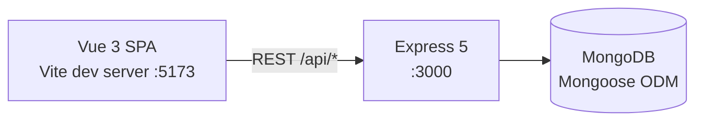

<p align="center">
  
</p>

# YRR — Sailing Race Results Manager

A full-stack web application for a sailing club ("Club des bateaux YRR"): manage boats, rating classes, race series and regattas, and compute race results using classic handicap systems (**PY** time-on-distance and **TMF** corrected-time coefficients).

> _Flags: [](https://vuejs.org/) [](https://vite.dev/) [](https://expressjs.com/) [](https://www.mongodb.com/)_

<!--
TODO (presentation): drop 2–3 screenshots into docs/ and link them here, e.g.:

-->

## Key features

- **Boats** — register fleet boats and link each to its rating class
- **Classes** — handicap definitions with two systems: PY (e.g. Laser 1100, Optimist 1642) and TMF (time coefficients)
- **Series** — group regattas into seasonal series (Spring, Summer…)
- **Races (Courses)** — create races within a series for a given class
- **Results (Résultats)** — record finishing points per boat/race, filterable by series

## Architecture



```
solutionYRR/
├── YRRfrontend/   # Vue 3 + Vite client
│   └── src/components/windows/   # one component per entity (Bateaux, Classes, Séries, Courses, Résultats…)
└── YRRbackend/    # Express API
    ├── models/    # Mongoose schemas (Bateau, Classe, Serie, Course, Resultat)
    ├── routes/    # REST routers, one per entity
    └── seed.js    # demo dataset loader (clears + re-inserts)
```

## API endpoints

| Route | Description |
|---|---|
| `GET/POST /api/bateaux`, `PUT/DELETE /:id` | Boats |
| `GET/POST /api/classes`, `PUT/DELETE /:id` | Rating classes (PY / TMF + handicap values) |
| `GET/POST /api/series`, `PUT/DELETE /:id` | Race series |
| `GET/POST /api/courses`, `PUT/DELETE /:id` | Races within a series |
| `GET/POST /api/resultats`, `PUT/DELETE /:id` | Results, `?serieId=` filter |

All endpoints also accept `DELETE /:id`.

## Getting started

### Prerequisites

- **Node.js** `^20.19.0` or `>= 22.12.0`
- **MongoDB** running locally (`mongodb://localhost:27017`) or an Atlas connection string

### 1. Backend

```sh
cd YRRbackend
npm install
```

Create `YRRbackend/.env`:

```env
MONGO_URI=mongodb://localhost:27017/yrr
PORT=3000
```

Optional — load the demo dataset (⚠️ truncates the `yrr` database first):

```sh
node seed.js
```

Start the API:

```sh
node server.js
```

### 2. Frontend

```sh
cd YRRfrontend
npm install
npm run dev
```

Open **http://localhost:5173**.

## Build for production

```sh
cd YRRfrontend
npm run build     # → YRRfrontend/dist/
npm run preview   # preview the production build locally
```

## Tech choices & notes

- The API base URL is defined per-component (`http://localhost:3000/api/...`). For a different port/host or a deployed backend, update those URLs — or better, move it to `VITE_API_URL` and read `import.meta.env`.
- CORS is open on the backend for easy local development.
- `seed.js` connects directly to `mongodb://localhost:27017/yrr` (hardcoded), while `server.js` uses `MONGO_URI` from `.env`.

## Roadmap

- [ ] Deployment (Render/Vercel + MongoDB Atlas)
- [ ] Centralize API base URL in an env var
- [ ] Request validation (zod / express-validator)
- [ ] Automatic handicap-corrected ranking per race
